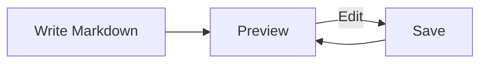
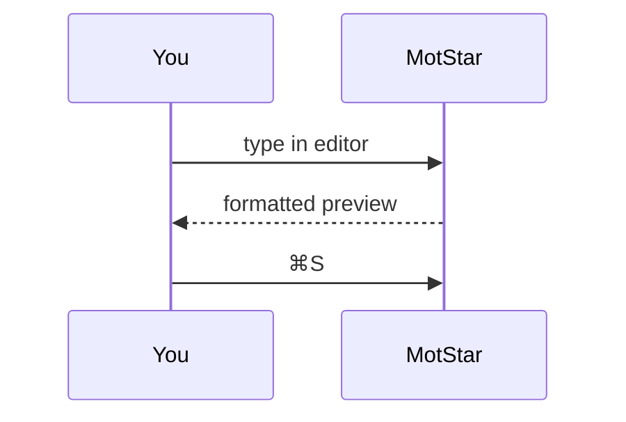

# Mermaid & editor test

## Flowchart



## Sequence diagram



## GFM kitchen sink

| Feature | Support |
| --- | --- |
| Tables | ✅ |
| ~~Strikethrough~~ | ✅ |
| `inline code` | ✅ |
| Task list | ✅ |

- [x] Created a Markdown file
- [x] Edited it in MotStar
- [ ] Tried Mermaid yet

> Block quote with **formatting**.

```python
def hello():
    return "world"
```


