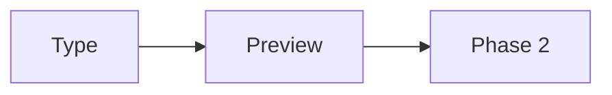

# Phase 2 features test

> [!note] Callout — Obsidian style
> This block quote starts with a callout marker and becomes a styled note box.

> [!warning] Heads up
> Danger callouts render in amber/orange.

## KaTeX maths

Inline maths: when \(a \ne 0\), the roots of $ax^2 + bx + c = 0$ are given by the quadratic formula:

$$x = \frac{-b \pm \sqrt{b^2 - 4ac}}{2a}$$

Fenced maths:

```math
\int_{-\infty}^{\infty} e^{-x^2}\,dx = \sqrt{\pi}
```

## Code highlighting

```swift
struct Note: Identifiable {
    let id = UUID()
    var title: String
    var body: String

    func preview() -> String {
        body.prefix(140).description
    }
}
```

```python
def fib(n: int) -> int:
    a, b = 0, 1
    for _ in range(n):
        a, b = b, a + b
    return a
```

```json
{ "app": "MotStar", "phase": 2, "features": ["math", "highlight", "emoji"] }
```

## Emoji shortcodes

:rocket: :fire: :tada: :heart: :thumbsup: :pizza: :coffee: :memo:

## Bare URLs auto-link

Visit https://www.markdownguide.org or www.github.com — no brackets needed.

## Footnotes

Obsidian-style note taking with footnotes.[^1] One document can hold several.[^2]

[^1]: First footnote — appears at the bottom with a backlink.
[^2]: Second footnote with `code` inside.

## Still working: Mermaid & tables

| Check | Status |
| --- | --- |
| KaTeX | ✅ |
| Highlight.js | ✅ |
| Footnotes | ✅ |
| Mermaid | ✅ |


