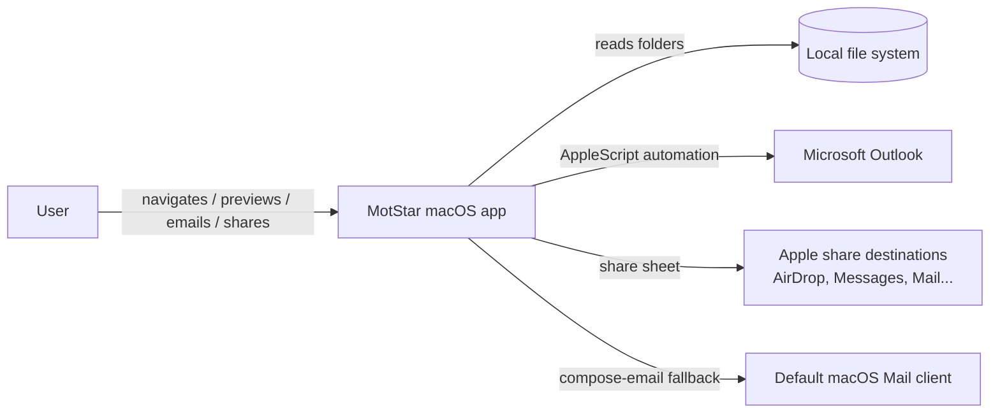

# MotStar — Software Design Document

**Version:** 0.2
**Date:** 2026-09-05
**Supersedes:** docs/01-product-specification.md (v0.1) — all open questions
(Q1–Q6) accepted with the recommended defaults.
**Related documents:** `docs/adr/ADR-001…007`

---

## 1. Overview

MotStar is a native macOS two-pane document navigator and previewer. Users
register local folders, expand a full recursive folder tree, and preview file
contents in place. Supported file types are visually tagged with colour
markers and standard icons. Selected files can be emailed through Microsoft
Outlook or shared through Apple's share sheet.

### Goals
- Native, fast, offline navigation of local folders.
- Persisted folder list across launches.
- Colour-coded file-type markers + standard icons.
- Rendered Markdown preview and Quick Look previews for PDF/Office/images.
- One-click Email (Outlook) and Share (Apple share sheet) for the selected
  file.

### Non-goals (v1)
- Editing files, search/indexing, cloud connectors, cross-platform support.

## 2. Context & Constraints

| Item | Decision |
|---|---|
| Platform | macOS 14+ (Sonoma minimum), Apple Silicon + Intel |
| UI toolkit | SwiftUI with targeted AppKit bridges (Quick Look, AppleScript, open panels, WKWebView) |
| Language | Swift 6 (tools version 5.10 for gradual concurrency) |
| Distribution | Developer-ID signed `.app` built from the SPM package; App Store path deferred |
| App Sandbox | Disabled for v1 (see ADR-003) |
| Email | AppleScript automation of Microsoft Outlook; compose-email fallback |
| Persistence | `UserDefaults` (paths as JSON) — no database needed |
| Dependencies | swift-markdown (Apple, build-time only). Runtime: Apple frameworks only (SwiftUI, AppKit, Quartz, WebKit, UniformTypeIdentifiers) |

## 3. Architecture

### 3.1 C4 Context



MotStar has exactly one external integration (Outlook) and otherwise talks to
the local file system. Everything is local and offline.

### 3.2 Container Diagram

```mermaid
flowchart TB
    subgraph MotStar
        W[WindowGroup<br/>ContentView]
        W --> SIDEBAR[Sidebar — FolderTreeView]
        W --> DETAIL[Detail — PreviewPane]
        SIDEBAR --> AS[AppState<br/>@Observable]
        DETAIL --> AS
        AS --> PS[PersistenceService<br/>UserDefaults]
        AS --> FA[FolderAccess<br/>NSOpenPanel]
        SIDEBAR --> TR[TreeNode<br/>lazy FS enumeration]
        DETAIL --> PR[PreviewRenderer<br/>Markdown / text]
        DETAIL --> QL[QuickLookView<br/>QLPreviewView]
        DETAIL --> EM[EmailService<br/>Outlook AppleScript]
        DETAIL --> SL[ShareLink]
    end
    TR --> FS[(File system)]
    PR --> FS
    QL --> FS
    EM --> O[Microsoft Outlook]
    SL --> S[Apple share sheet]
```

### 3.3 Component responsibilities

| Component | Responsibility |
|---|---|
| `AppState` | Single source of truth: root folders, tree roots, selected file URL |
| `TreeNode` | One folder/file node; lazily enumerates children on first expand |
| `FileTypeRegistry` | Extension/UTI → kind, colour marker, SF Symbol icon |
| `FolderAccess` | Folder picker (NSOpenPanel) |
| `PersistenceService` | Load/save root folder paths (JSON in UserDefaults) |
| `PreviewRenderer` | `.md` → HTML via swift-markdown (`MarkdownHTML`), `.txt` → plain text |
| `FormattedMarkdownView` | Offline WKWebView renderer with bundled CSS; JS disabled, links open externally (ADR-008) |
| `QuickLookView` | `NSViewRepresentable` wrapping `QLPreviewView` for PDF/DOCX/PPTX/XLSX/JPG/PNG |
| `EmailService` | Outlook via AppleScript; compose-email fallback; error surfacing |
| `ShareLink` | Native SwiftUI share sheet for the selected file |

## 4. Key Architectural Decisions

Each decision is detailed in `docs/adr/`:

- **ADR-001** Native SwiftUI, macOS 14+, no cross-platform ambition.
- **ADR-002** Root-folder persistence in `UserDefaults` as JSON paths.
- **ADR-003** App Sandbox off in v1; revisit for App Store / notarization.
- **ADR-004** Quick Look for non-text previews; Markdown rendered natively.
- **ADR-005** Email via Outlook AppleScript automation with graceful fallback.
- **ADR-006** Lazy, depth-on-demand tree enumeration; hidden files filtered.
- **ADR-007** Central file-type registry as the single source of truth for
  marker colour, icon, and preview strategy.
- **ADR-008** Neat Markdown rendering via swift-markdown + offline WKWebView,
  with a Formatted/Raw toggle in the preview toolbar.

## 5. Data Model

### 5.1 Persisted state (UserDefaults, key `rootFolders`)

JSON array of:

```json
[
  { "path": "/Users/john/Documents/Projects", "addedAt": "2026-09-05T09:00:00Z" }
]
```

No database is warranted: state is one small array. Expanded-state
persistence is a documented enhancement (ADR-002).

### 5.2 In-memory model

| Entity | Fields | Notes |
|---|---|---|
| `TreeNode` | `url`, `name`, `isFolder`, `children: [TreeNode]?`, `error` | Class, `ObservableObject`; `children == nil` means not yet enumerated |
| `AppState` | `roots: [RootFolder]`, `selectedURL: URL?` | `@Observable`, injected via `@Environment` |
| `RootFolder` | `path`, `addedAt`, `resolvedURL` | Stored + resolved at launch |

### 5.3 File type registry (single source of truth)

| Kind | Extensions | Colour | Symbol |
|---|---|---|---|
| markdown | md | Indigo `#6366F1` | `doc.richtext` |
| text | txt | Grey `#9CA3AF` | `doc.plaintext` |
| pdf | pdf | Red `#E53E3E` | `doc.richtext` |
| docx | docx | Word blue `#2B579A` | `doc.text` |
| pptx | pptx | Orange `#D24726` | `chart.bar.doc.horizontal` |
| xlsx | xlsx | Green `#217346` | `tablecells` |
| image | jpg jpeg png | Cyan `#06B6D4` | `photo` |
| other | — | Grey | `doc` |

Classification: extension first (case-insensitive), UTI fallback. Unknown
types: generic icon, grey marker, Quick Look preview (per accepted Q3).

## 6. Internal Contracts ("API")

There is no external network API. Internal seams:

- `FileTypeRegistry.kind(for url: URL) -> FileKind`
- `TreeNode.loadChildren()` — populates children synchronously on a
  background queue, published on main; returns on error state instead of
  throwing (folder disappeared).
- `EmailService.send(url: URL, completion: (Result<Void, EmailError>) -> Void)`
  — Outlook first, compose-email fallback.
- `PreviewPane` renders per kind: `.markdown/.text` text path; otherwise
  Quick Look.

Error strategy: user-visible `Alert`/inline error state per row; app never
crashes on missing/unreadable folders (NFR).

## 7. Security

- **Local-only:** no telemetry, no network calls (spec §6).
- **Data classification:** file names and paths are user content — treated as
  sensitive; nothing is logged to disk or sent anywhere except the explicit
  user actions Email/Share.
- **Automation permission:** first Outlook email triggers macOS TCC prompt
  ("MotStar wants to control Microsoft Outlook"). Handle denial gracefully.
- **Sandbox:** off for v1 (ADR-003). Revisit adds security-scoped bookmarks
  (schema already stores paths + `addedAt`, easy to extend).
- **No secrets:** app stores no credentials. Outlook email is composed and
  **not** auto-sent — the user reviews and sends from Outlook (FR-11).
- **App Transport:** n/a (no networking).

## 8. Deployment & Operations

- Build: `swift build -c release` from `Package.swift`; bundle into
  `MotStar.app` with a small packaging script (`scripts/bundle-app.sh`):
  Info.plist, icon, `Contents/MacOS` layout.
- Run during development: open `Package.swift` in Xcode (≥ 15) and Run the
  `MotStar` executable target, or `swift run MotStar`.
- Signing: Developer ID + notarization when distributing outside the Mac App
  Store; App Store path requires enabling the sandbox (ADR-003 follow-up).
- Updates: v1 manual distribution; roadmap: Sparkle or App Store.

## 9. Testing Strategy

| Level | Approach |
|---|---|
| Unit | Registry classification; persistence round-trip; TreeNode enumeration (fixtures in `Tests/`) |
| Integration | Scriptable smoke: add folder → expand → select → preview; Outlook present vs absent |
| Manual | Two-pane UX, Quick Look rendering of each registered type, share sheet destinations, relaunch restore |

`swift test` runs unit tests (registry + persistence first; tree tests use a
temp directory fixture).

## 10. Roadmap / Future Work

1. Persist expanded-tree state and last-selected file (ADR-002 extension).
2. App Sandbox + security-scoped bookmarks for App Store distribution.
3. ~~Richer Markdown (tables/fenced code)~~ — **done in v0.2 via ADR-008**
   (swift-markdown + offline WKWebView; Formatted/Raw toggle).
4. Folder watching (FSEvents) for live tree updates.
5. .docx/.xlsx/.pptx text extraction for instant text previews alongside Quick
   Look thumbnails.
6. Keyboard shortcuts and quick-open palette.

## 11. Open Items

- None blocking. Outstanding: signing identity/team id for distribution,
  app icon artwork, exact Outlook version used for testing.
